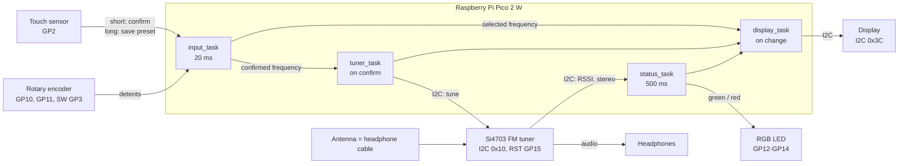
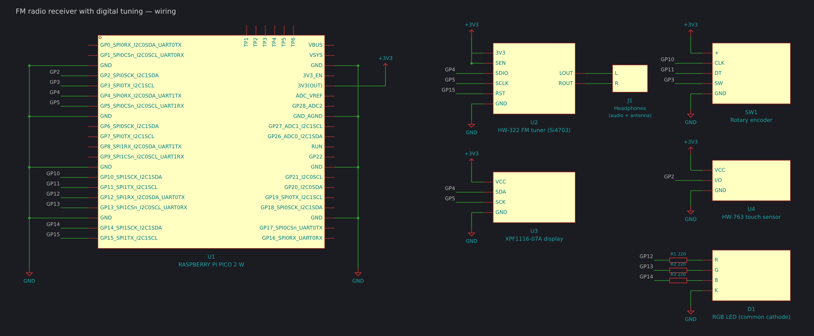

# FM-radio-receiver-with-digital-tuning

# Team Members:

- Pažítka Samuel - Rotary Encoder, Touch Sensor, Git Maintenance
- Pupík Milan - I2C Communication, Display Driver
- Řihák Petr - FM Tuner, RGB LED Diode

# Overview
Our project is an FM radio receiver with digital tuning realized on a Raspberry Pi Pico 2 W. The user selects a frequency with a rotary encoder and confirms it by touching a touch sensor. The frequency and radio parameters are shown on a display and the audio is played on headphones connected directly to the tuner module. RGB LED indicates whether a station is received (green) or not (red). A long touch saves the current station as a preset. The headphone cable also serves as the FM antenna.

The software is comprised of a main application ([main.py](src/main.py)), a configuration file ([config.py](src/config.py)) and a reusable class for every hardware component in [drivers](src/drivers): [Si4703](src/drivers/si4703.py), [Display](src/drivers/display.py), [RotaryEncoder](src/drivers/rotary_encoder.py), [TouchButton](src/drivers/touch_sensor.py) and [RgbLed](src/drivers/rgb_led.py).

# Component list

| Component | Function | Interface | Supply |
|---|---|---|---|
| Raspberry Pi Pico 2 W | microcontroller (RP2350), MicroPython | — | USB 5 V |
| Pico Gravity Board V3.0 | connector board for the Pico | — | from Pico |
| HW-322 FM tuner (Si4703), headphone jack | FM reception, audio output | I2C (0x10) + RST | 3.3 V |
| XPF1116-07A display | frequency and status | I2C (0x3C) | 3.3 V |
| Rotary encoder with push-button | tuning | 2× GPIO (IRQ) + GPIO | 3.3 V |
| HW-763 touch sensor (TTP223) | confirm frequency / save preset | GPIO | 3.3 V |
| RGB LED | signal indication | 3× PWM | — |
| Headphones | audio output and antenna | 3.5 mm jack | — |

# Block Diagram


# Pin/Bus Plan

## Buses

| Bus | Pins | Speed | Devices |
|---|---|---|---|
| `I2C0` | SDA `D/4`, SCL `C/5` | 400 kHz | Si4703 FM tuner (`0x10`), display (`0x3C`) |

## Pins

| Pico 2 W pin | Direction | Signal | Component | Note |
|---|---|---|---|---|
| `GP2` | input | `I/O` | HW-763 touch sensor | active HIGH; short touch = confirm, long touch = save preset |
| `GP21` | input | `SW` | rotary encoder | internal pull-up, active LOW; reserved |
| `GP19` | input | `CLK` | rotary encoder | internal pull-up, IRQ on both edges |
| `GP20` | input | `DT` | rotary encoder | internal pull-up, IRQ on both edges |
| `GP12` | output (PWM) | `R` | RGB LED | through R1 220 Ω; no station |
| `GP13` | output (PWM) | `G` | RGB LED | through R2 220 Ω; station received |
| `GP14` | output (PWM) | `B` | RGB LED | through R3 220 Ω; reserved |
| `GP15` | output | `RST` | Si4703 | reset and bus-mode selection |

## Power

| Pico 2 W pin | Connected to |
|---|---|
| `3V3(OUT)` | Si4703 `3V3` and `SEN`, display `VCC`, encoder `+`, touch sensor `VCC` |
| `GND` | all module grounds, RGB LED common cathode |

# Wiring Diagram



# Timing

We are using `uasyncio` tasks so that input handling, tuning and display updates never block each other.

| Activity | Runs as | Interval | Responsibility |
|---|---|---|---|
| Encoder edge | GPIO interrupt | on edge | only updates a transition counter |
| `input_task` | `uasyncio` task | 20 ms | reads encoder detents and changes the selected frequency; reads the touch sensor (short = confirm, long = save preset) |
| `tuner_task` | `uasyncio` task | on confirm | sends the confirmed frequency to the tuner |
| `status_task` | `uasyncio` task | 500 ms | reads RSSI and stereo status, sets the RGB LED |
| `display_task` | `uasyncio` task | on change, max. 5 Hz | redraws the display |

# Repository Structure

```
src/
├── main.py                # application 
├── config.py              # pins, band limits, timing constants
└── drivers/
    ├── rotary_encoder.py  # RotaryEncoder – quadrature decoder + button
    ├── touch_button.py    # TouchButton – HW-763 touch sensor
    ├── tuner.py          # Si4703 – FM tuner 
    ├── display.py         # Display – OLED output 
    └── rgb_led.py         # RgbLed – status LED 
tests/                     # stand-alone test of each component
docs/                      # Sphinx documentation source
images/                    # diagrams, photos, screenshots
poster/                    # A3 poster

```

# Media
- **A3 poster** – *Soon*
- **Video demonstration** – *Soon*

# References and Tools
## Tools
- **VS Code + MicroPico:** Development and upload of MicroPython code.
- **Sphinx:** Generation of the API documentation.
- **Git/GitHub:** Version control and documentation.
- **Claude:** Used for general tech-support and verification.

- ## References
- **[MicroPython course labs, T. Frýza, BUT](<https://gitlab.fekt.vut.cz/fryza/micropython-course-labs>)**
- **[MicroPython documentation – RP2 quick reference](<https://docs.micropython.org/en/latest/rp2/quickref.html>)**
- **Silicon Labs – Si4702/03-C19 data sheet and AN230 Programming Guide**

